# Wpayin Wallet for Android

Native Android port of Wpayin Wallet, isolated from the iOS project in its own
folder. The UI is written in Kotlin and Jetpack Compose. Real key generation and
address derivation use Trust Wallet Core; no test or substitute cryptography is
used in production builds.

> Security status: this Android port has not received an independent security
> audit. Use only test wallets and test funds until the production Wallet Core
> build, on-device signing tests, and the full release checklist are complete.

## Screenshots

Captured from the native Android `previewDebug` build on a Pixel 9 emulator
(1080 × 2424). The debug-only screenshot fixture uses deterministic sample
balances, public addresses, and transactions; it never contains wallet keys.

<p align="center">
  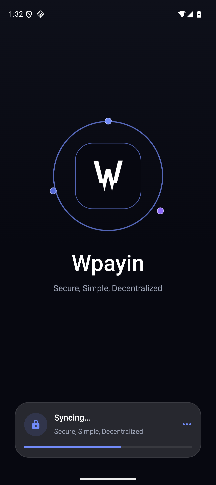
  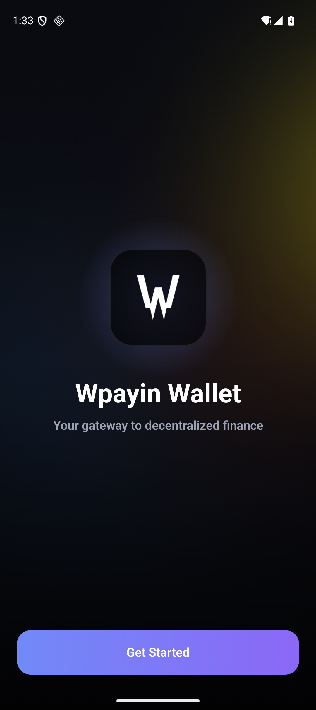
  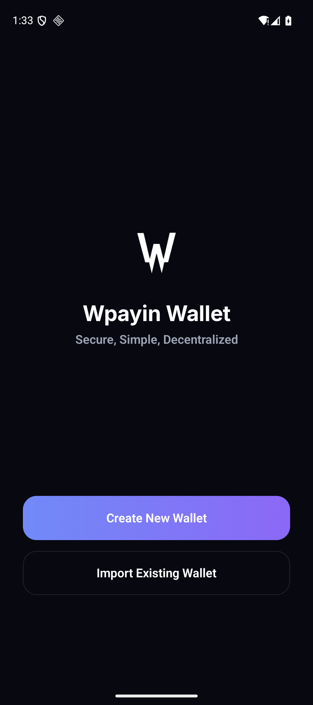
</p>
<p align="center">
  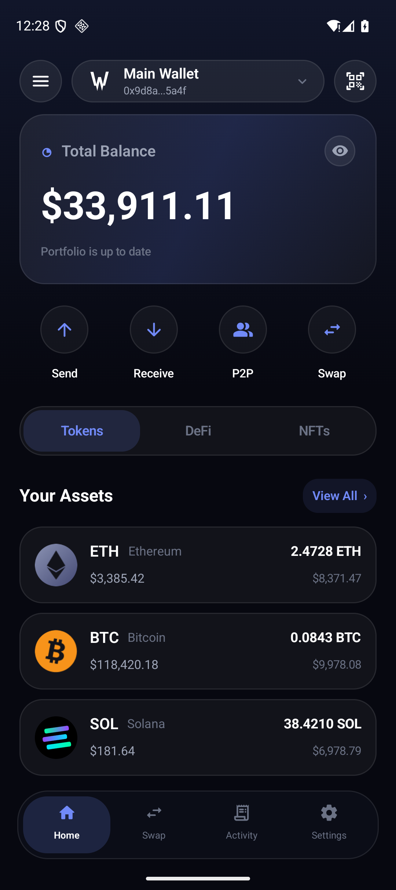
  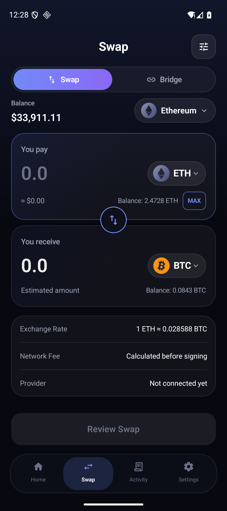
  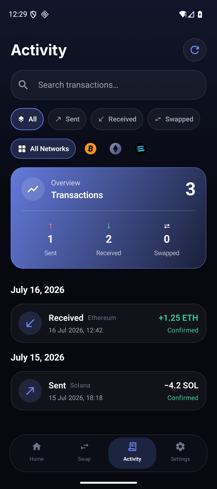
</p>
<p align="center">
  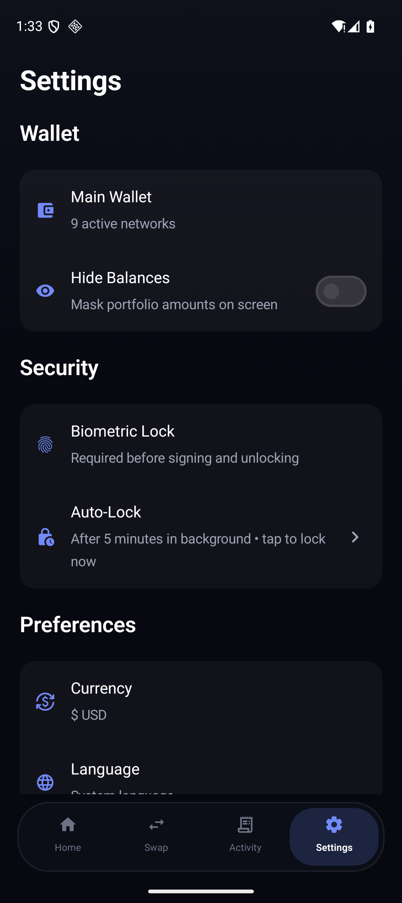
  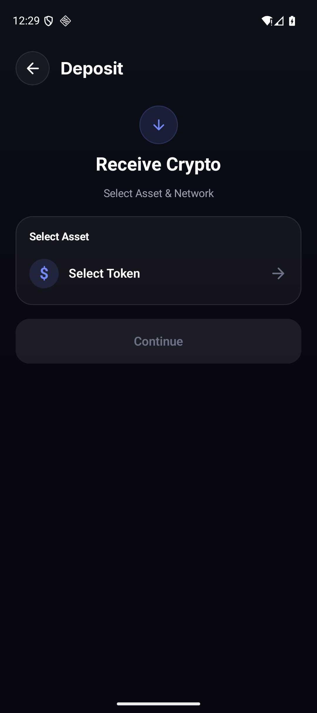
  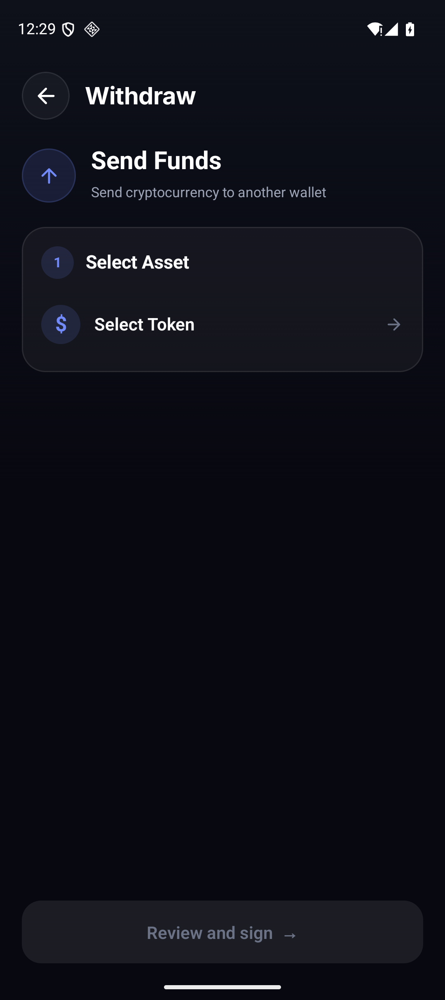
</p>
<p align="center">
  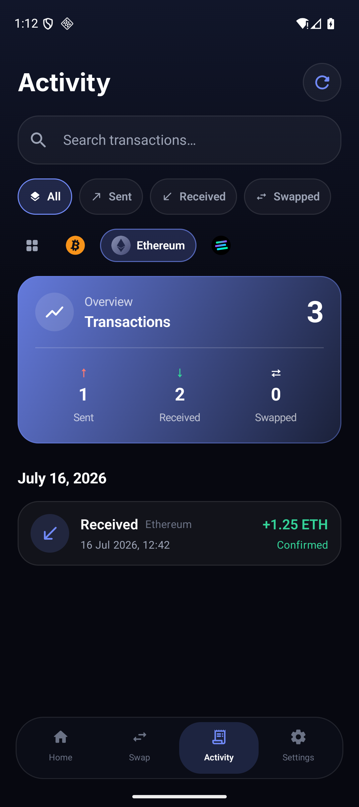
  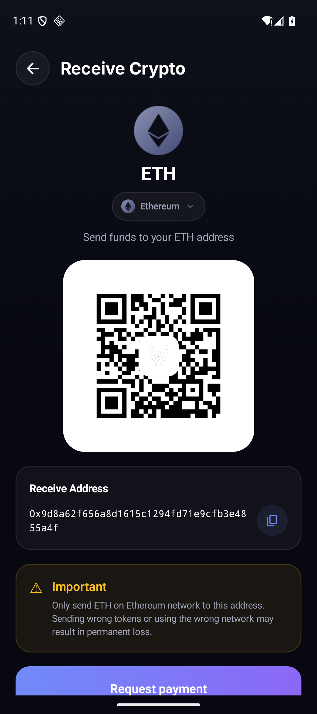
  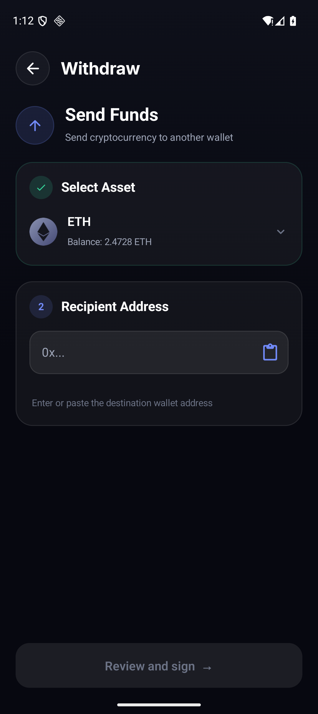
</p>
<p align="center">
  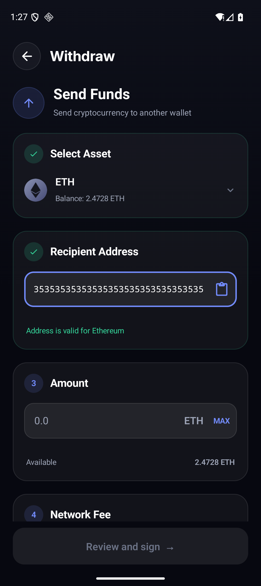
  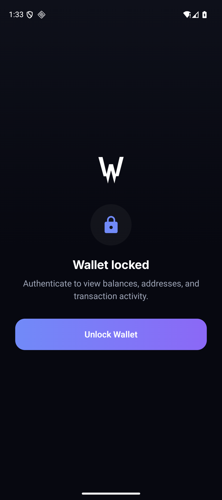
</p>

## Toolchain

- Android Studio Quail 2 (2026.1.2) or compatible
- JDK 17 or newer
- Android SDK Platform 37.0 (`platforms;android-37.0`)
- Android SDK Build Tools 36.0.0
- Gradle 9.4.1 (included wrapper)
- minSdk 26 / targetSdk 37

## Build variants

The project intentionally separates visual development from real wallet
operations:

- `previewDebug` builds without Wallet Core credentials. Create/import actions
  are disabled and no wallet material can be generated.
- `walletCoreDebug` and `walletCoreRelease` include official Trust Wallet Core
  4.6.13 from GitHub Packages and enable real key/address operations.

Build the safe preview:

```bash
./gradlew :app:assemblePreviewDebug
```

The APK is written to:

```text
app/build/outputs/apk/preview/debug/app-preview-debug.apk
```

## Trust Wallet Core access

GitHub Packages requires a GitHub username and a classic read-only token with
`read:packages`. Put them in the untracked `local.properties` file:

```properties
sdk.dir=/absolute/path/to/Android/sdk
gpr.user=YOUR_GITHUB_USERNAME
gpr.key=YOUR_READ_PACKAGES_TOKEN
```

Alternatively use `~/.gradle/gradle.properties`, `GITHUB_ACTOR` plus
`GITHUB_TOKEN`, or Gradle `-P` properties. Never commit credentials.

Then run:

```bash
./gradlew :app:assembleWalletCoreDebug
```

The Wallet Core flavor also contains on-device deterministic tests for EVM,
native Solana, and native SegWit Bitcoin signing. With an emulator or device
connected, run:

```bash
./gradlew :app:connectedWalletCoreDebugAndroidTest
```

## Configuration

Optional public API identifiers can be supplied as Gradle properties without
checking them into the repository:

```properties
COINGECKO_API_KEY=...
ETHERSCAN_API_KEY=...
```

The base wallet and native balance refresh still work without these optional
values.

## Implemented foundation

- Compose recreation of onboarding, welcome, home, swap, activity, settings,
  create/import, and receive flows
- original Wpayin visual assets and theme, including shared iOS-matched token
  and network icons
- Bitcoin, Ethereum, Solana, BNB Chain, Polygon, Arbitrum, Optimism, Avalanche,
  and Base account derivation through Wallet Core
- mnemonic and EVM private-key import
- AES-256-GCM encryption with a non-exportable Android Keystore key
- backups/device transfer disabled for wallet files and preferences
- screen-capture protection (`FLAG_SECURE`)
- native balance fetching with RPC failover and CoinGecko USD prices
- allowlisted ERC-20/BEP-20 balances on seven EVM networks, matching the iOS catalog
- custom EVM-token import with verified on-chain name, symbol, decimals, bytecode, balances, and removal
- Etherscan V2 history when configured, public Blockscout fallbacks, Bitcoin history through Blockstream-compatible APIs, and native Solana history through RPC
- reviewed EVM native/ERC-20, Bitcoin native SegWit, and native Solana transfers with exact atomic-unit conversion, fee refresh, official Wallet Core signing, and RPC broadcast
- biometric/device authentication before signing, cold-start locking, manual locking, and automatic locking after five minutes in the background
- real, scannable receive QR codes and explorer links
- preview/product flavor boundary preventing fake crypto in production
- unit coverage for address/amount/ABI/Base58 encoding plus production-flavor on-device signing vectors

## Parity work still required before release

| Area | Status |
| --- | --- |
| Create/import and account derivation | Implemented; device testing required |
| Native balances and prices | Implemented; provider/failover testing required |
| Receive QR/address flows | Implemented |
| ERC-20/SPL token discovery and balances | Known and custom ERC-20/BEP-20 implemented; SPL tokens pending |
| EVM/Bitcoin/Solana signing and broadcast | Implemented in Wallet Core flavor; production dependency build and device tests required |
| Transaction history/indexing | EVM, Bitcoin, and native Solana implemented; provider testing required |
| Swap and LI.FI bridge execution | UI only; signing deliberately disabled |
| P2P atomic trading and public offer board | Pending |
| NFT discovery/spam filter | Pending |
| WalletConnect/Reown WalletKit | Pending |
| Biometric signing gate and auto-lock | Implemented; device testing required |
| Full 8-language localization | Czech/English base only |
| Security audit, release signing, Play policy work | Required before production |

## Security notes

- Never log recovery phrases, private keys, raw signed payloads, or provider
  credentials.
- Wallet Core handles key derivation/signing only; RPC responses, fee
  calculation, transaction creation, and broadcast still require defensive
  validation.
- Do not enable unfinished send/swap/P2P actions merely for UI completeness.
- Test all signing code on test accounts with small balances, and arrange an
  independent audit before a public release.
